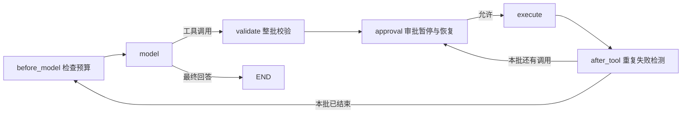

# 从 LangChain 到 LangGraph，再到 Deep Agents

这套代码继续使用“小店客服助手”：查订单、查物流、提取售后诉求、审批退款、生成报告。每个文件讲一个主要机制，可以单独运行。

本教程配合[资料库 13《LangChain 家族框架讲解》](https://my.feishu.cn/wiki/ByAnwYnPdiDXq4kBjybcpyWFntd)，章节映射核对于 2026-10-28（revision 98）。从 LangChain 组件与 Agent 循环，到 LangGraph 运行时，再到 Deep Agents Harness，统一使用小店业务理解三层接口。

## 1. 先知道三个框架分别负责什么

| 你要做的事 | 从哪里开始 | 这套代码 |
|---|---|---|
| 输入问题，按固定步骤调用模型、处理结果 | LangChain 的 Prompt / Model / Parser | `p13b`、`p13c` |
| 让模型自行选择工具，直到能回答 | LangChain `create_agent` | `p13d` |
| 精确控制循环、并行、审批、恢复和状态 | LangGraph `StateGraph` | `p13a`、`p13e`～`p13h`、`p13j` |
| 开放式长任务，需要文件、委派和上下文管理 | Deep Agents `create_deep_agent` | `p13i` |

`create_agent` 基于 LangGraph；Deep Agents 在 LangChain Agent 之上预装更多能力，也使用 LangGraph 运行时。选择更底层的接口，是为了显式控制流程；选择 Harness，是为了复用文件工作区、子任务和上下文管理。

## 2. 环境与运行方式

在本教程所在的 `agent-learning` 目录运行命令。装好 `uv` 后先运行一次 `uv sync`，它会准备 Python 3.12、创建 `.venv` 并安装 `pyproject.toml` 里的全部依赖，详见 README 的「一步配置环境」。

先运行不需要模型的部分：

```bash
bash run_frameworks.sh --offline
```

它运行 `p13a`、`p13f`、`p13g`、`p13h`、`p13j`。这里的 offline 指不调用模型。

要调用模型，先编辑本目录的 `.env`（格式见 `.env.example`），填写 `LLM_API_KEY`、`LLM_MODEL` 和 `LLM_BASE_URL`，然后直接运行：

```bash
uv run p13b_langchain_chain.py
bash run_frameworks.sh --all
```

也可以自行设置 `LLM_API_KEY`、`LLM_MODEL`，第三方服务再配置 `LLM_BASE_URL`。`setting.py` 使用 `Settings(BaseSettings)` 和 `env_file=find_dotenv() or None` 统一读取 `.env`，非空环境变量优先。`_langchain.make_model()` 直接使用 `settings.llm_model`、`settings.llm_api_key` 和 `settings.llm_base_url` 创建 `ChatOpenAI`，走 Chat Completions 接口；不设置地址时使用 OpenAI 官方地址。

模型能力要求：

- `p13b` 需要普通对话与流式输出。
- `p13c`、`p13d`、`p13e`、`p13i` 需要 tool calling；`p13e` 还演示流式工具调用。
- “兼容 OpenAI”不等于支持所有能力。若供应商不支持工具调用、流式工具参数或结构化输出，需要换支持对应能力的模型。
- 调用模型会产生费用。Deep Agents 可能调用多个子任务，成本和执行路径都不是固定值。

依赖范围统一写在 `pyproject.toml`，实际版本由 `uv.lock` 固定。Deep Agents 仍是 0.x，示例固定到 `0.7.32`，采用该版本的 `StateBackend()` 实例接口；不要混用旧教程中的 backend factory 写法。

## 3. 建议阅读顺序

| 顺序 | 文件 | 运行后重点看 |
|---|---|---|
| 1 | [p13b_langchain_chain.py](p13b_langchain_chain.py) | 同一条链如何执行单次、批量和流式调用 |
| 2 | [p13c_langchain_structured.py](p13c_langchain_structured.py) | 模型输出对象之后，代码为什么还要检查订单归属 |
| 3 | [p13d_langchain_agent.py](p13d_langchain_agent.py) | 模型请求工具、工具返回结果、模型继续回答 |
| 4 | [p13a_langgraph_basics.py](p13a_langgraph_basics.py) | State、节点、条件边、审批和检查点的基本形状 |
| 5 | [p13e_langgraph_react.py](p13e_langgraph_react.py) | 把第 3 步封装的循环展开为显式图 |
| 6 | [p13f_langgraph_map_reduce.py](p13f_langgraph_map_reduce.py) | 并行写冲突、动态分支和汇合 |
| 7 | [p13g_langgraph_persistence.py](p13g_langgraph_persistence.py) | 退出进程后恢复审批，节点从头重跑 |
| 8 | [p13h_langgraph_store.py](p13h_langgraph_store.py) | 会话状态与跨会话偏好有什么区别 |
| 9 | [p13j_langgraph_time_travel.py](p13j_langgraph_time_travel.py) | 从历史点创建新分支，保留原始结果 |
| 10 | [p13i_deepagents_harness.py](p13i_deepagents_harness.py) | 委派、文件工作区、规划与工具审批怎样组合 |

学习时按上表顺序运行；文件名用于稳定引用，不必严格按字母顺序。

## 4. LangChain：先把模型接成固定流程

### 4.1 Prompt → Model → Parser

`p13b` 的核心只有一行：

```python
chain = prompt | make_model() | StrOutputParser()
```

这里 `|` 把前一步的输出传给后一步。数据依次变为：

```text
{"question": "退货运费谁出？"}
  → ChatPromptValue（格式化后的消息）
  → AIMessage（模型回复，带内容、用量等信息）
  → str（提取出的文本）
```

模板使用 `partial` 绑定本地退货政策，每次只需要传问题。政策实际进入了模型的 system 消息，而不是只检索后打印一下。

`invoke` 处理一次输入；`batch` 处理多个独立输入，结果顺序与输入顺序一致；`stream` 逐步返回文本片段。`batch` 的并发由 `max_concurrency` 控制，批量请求不意味着免费。这个示例发起四次模型请求。

**练习：**移除 `StrOutputParser()`，打印 `AIMessage` 的 `content`、`usage_metadata`，理解解析器到底帮你省了什么。

### 4.2 结构化输出不等于业务授权

`p13c` 用 Pydantic 定义 `AfterSale`：订单号、问题描述、诉求。`with_structured_output(..., method="function_calling")` 把 Schema 转成工具调用形式，再把模型返回值解析成对象。

`include_raw=True` 返回 `raw`、`parsed` 和 `parsing_error`，方便看清“模型返回了什么”和“有没有成功解析”。它不吞掉鉴权、网络或供应商接口错误。

三组输入对应三个观察点：

| 输入 | 字段解析之后还要做什么 |
|---|---|
| `ORD-20261001` 的耳机坏了 | 查询当前顾客的订单，关卡通过后登记诉求 |
| 耳机坏了，没有订单号 | 追问订单号，不能凭空补一个 |
| `ORD-20261003` 的杯子漏水 | 格式合法，但订单属于别人，查询被拒绝 |

模型只负责抽取。归属检查由 `_shop.execute()` 完成，当前顾客身份不出现在模型可填写的参数里。

**练习：**增加一个紧急程度枚举，再决定是否转人工。不要让模型填一个 `authorized=True` 就绕过业务检查。

### 4.3 `create_agent` 帮你管理模型与工具循环

`p13d` 把 `ChatOpenAI`、三个订单工具、system prompt 和 checkpointer 传入 `create_agent`。主循环是：

```text
用户问题 → 模型 → 有 tool_calls？ → 执行工具 → 模型
                    └─ 没有 → 最终回答
```

`@tool` 将 Python 函数的说明和参数变成工具 Schema。模型返回的是调用请求，真正执行函数的是框架；请求工具并不等于工具已经成功。

第一次查物流，第二次问“这笔订单买的什么”。第二轮只传新消息，框架按相同 `thread_id` 读取之前的消息。不要把整段历史再传一次，避免重复加入。换一个 thread，检查点状态就是空的。

`InMemorySaver` 仅在当前进程有效。`recursion_limit` 限制图的执行步数，不是模型调用次数、请求超时或 token 预算；达到上限会报 `GraphRecursionError`。

**对照阅读：**`p07a_react_loop.py` 是手写循环；`p13d` 是预置循环；`p13e` 是自己建图。三者负责的核心过程相同，控制权的位置不同。

## 5. LangGraph：把文档中的机制跑出来

### 5.1 State 更新与显式 ReAct 图

先看 `p13a` 的普通字典状态，再看 `p13e` 的 `MessagesState`。节点返回状态的**增量更新**，不需要复制整个状态。

消息字段使用 `add_messages`：不同 message id 追加，相同 id 更新。它不是按文本内容去重；每次重放都生成新 id 的消息，仍然可能被追加。普通列表上的 `operator.add` 则只是拼接。

`p13e` 中的三个接口分工如下：

| 接口 | 做什么 |
|---|---|
| `model.bind_tools(...)` | 告诉模型有哪些工具、参数是什么 |
| `ToolNode(...)` | 执行请求，返回带对应 `tool_call_id` 的 `ToolMessage` |
| `tools_condition` | 查看最后一条消息，有调用请求就去 tools，否则结束 |

工具执行后必须通过边回到 model，否则模型无法根据工具结果生成最终回答。

流式输出同时开启 `updates` 和 `messages`，所以每次得到 `(mode, chunk)`。前者是节点的增量更新；后者是模型文本片段和节点元信息。token 片段不保证等同一个完整词、句子或最终工具参数。

**练习：**仅保留 `updates`，记录执行节点序列；再换成 `values`，比较增量与完整状态。

### 5.2 super-step、reducer 和动态并行

`p13f` 首先让 A、B 同轮写一个没有 reducer 的 `findings` 字段，捕获预期的 `InvalidUpdateError`。框架不会替你决定谁覆盖谁。

接着用 `Send("analyze", payload)` 按文档数量动态派发任务。每个分支收到自己的 `index`、`doc` 和分支启动前的计数，返回一个 finding。`operator.add` 把这些增量合并，`defer=True` 的汇总节点等待待执行任务完成后再运行。

```text
START → Send(analyze, 文档 1) ─┐
      → Send(analyze, 文档 2) ─┼→ 合并 findings → summarize → END
      → Send(analyze, 文档 3) ─┘
```

所有分支的 `before_count` 都是 0：Send 传入的是分支开始前的快照，不会自动得到同一轮其他分支刚产生的结果。汇总时按显式 `index` 排序，不把业务顺序寄托在并行完成顺序上。空文档列表也有通向汇总的路径。

这里的 analyze 故意用普通函数，便于稳定观察调度。理解之后，可在节点内部接模型提取要点，控制流不需要改变。

### 5.3 真正跨进程的审批恢复

`p13g` 不传参数时会创建临时 SQLite 数据库，启动一个子进程跑到审批点并退出，再启动另一个子进程批准。自动演示结束后清理临时文件。

手动分两次运行，更容易观察“进程已经退出”：

```bash
uv run p13g_langgraph_persistence.py start --db /tmp/shop-approval.sqlite --thread-id lesson-1
uv run p13g_langgraph_persistence.py approve --db /tmp/shop-approval.sqlite --thread-id lesson-1
```

也可以将第二条命令中的 `approve` 换成 `reject`。重复上课请使用新的 `--thread-id`；已经完成的任务不能再次审批。

观察两次出现的“进入 approve 节点”：**恢复会从节点开头重新执行**。第二次执行到 `interrupt()` 时，它返回传入的恢复值。审批节点用 `Command(goto=...)` 决定去退款还是取消，不再添加无条件出边。

这里退款仅返回演示文本。真实业务即使把付款拆成独立节点，仍然需要幂等键；拆节点或开启 checkpoint 都不保证外部付款只发生一次。

`durability` 传给 `invoke` / `stream`：`sync` 等保存完成再进入下一步，`async` 允许下一步执行与保存重叠，`exit` 在退出运行时保存、无法保护进程崩溃前的全部中间进度。是否真正落盘还取决于后端：内存检查点不会因为设置 `sync` 就变成磁盘存储。

### 5.4 Checkpointer、Store、Runtime Context

`p13h` 连跑三个会话：

1. 用户 u1 在会话 1 确认“简短中文，先给结论”，写入 Store。
2. 用户 u1 开会话 2，checkpoint 是空的，但 Store 仍能读取偏好。
3. 用户 u2 开会话 3，使用另一个 namespace，读不到 u1 的偏好。

| 数据 | 放哪里 | 示例 |
|---|---|---|
| 当前流程中会变化的内容 | State / Checkpointer | 当前问题、回答、下一步节点 |
| 跨会话复用的数据 | Store | 用户回复风格 |
| 本次调用由系统提供的依赖或身份 | Runtime Context | `user_id` |

本例的 Store 和 Checkpointer 都是内存实现。跨 thread 可用不等于跨进程保留，关闭程序就丢失。没有配置 embedding 的 Store 也不会自动具备语义检索；本例用 `get(namespace, key)` 进行确定性读取。

namespace 是程序的隔离约定，仍需要服务端鉴权；不能把前端任意提交的 user_id 或 thread_id 当作授权证明。

### 5.5 时间旅行要接住新的 checkpoint config

`p13j` 先运行普通配送报价，再从历史中找到 `next == ("quote",)` 的状态，把配送改为加急并重跑：

```python
branch_config = graph.update_state(past.config, {"shipping": "加急"})
branch = graph.invoke(None, branch_config)
```

`update_state` 创建新 checkpoint，并返回新配置。拿旧 `past.config` 继续，会回到旧检查点；应当使用返回的 `branch_config`。示例最后通过保存的 `original_config` 读取原结果，证明原始历史没有被覆盖。

时间旅行也不会撤销已经发出的邮件或扣款。因此这里选择纯报价计算，不连接真实外部操作。

## 6. Deep Agents：把能力组合成订单报告工作台

`p13i` 以“主 Agent 委派、收集结果、生成产物”为主线，使用小店订单工具完成核查和报告。

| 文档能力 | 示例中的落点 |
|---|---|
| 子 Agent 隔离 | `order_researcher` 使用订单工具核查，主 Agent 通过 `task` 获取结论 |
| 虚拟文件系统 | `StateBackend()`，报告写到 `/reports/order.md` |
| Memory | 在虚拟工作区预置 `/memory/AGENTS.md`，启动时加载固定指令 |
| Skills | 预置 `/skills/order-report/SKILL.md`，按需读取报告写法 |
| 可选规划 | 显式添加 `TodoListMiddleware()`，提供 `write_todos` |
| 人工介入 | `interrupt_on` 在 `write_file` 执行前暂停 |
| 上下文管理 | 使用 Harness 的默认能力；本例较短，不保证触发自动总结或大结果卸载 |

运行：

```bash
uv run p13i_deepagents_harness.py
uv run p13i_deepagents_harness.py --decision reject
```

默认 `approve` 和显式 `reject` 都是**教学预设决定**，用于重复演示，不代表真实人工已经审核。脚本会打印待审批工具及参数，再按 interrupt id 填入对应的 `decisions`，使用相同 thread 恢复。一次中断内有多个待审批动作时，决定列表按请求顺序一一对应。

主 Agent 的消息中可以观察到 `task` 调用及其结果，不会自然包含子 Agent 全部内部消息。示例也打印任务清单和虚拟文件列表；若拒绝写入或模型未调用写文件工具，会明确显示没有报告文件。

`/reports/order.md` 是**图状态里的虚拟文件**，不会出现在电脑的 `/reports` 目录，也没有把当前仓库交给 Agent 操作。配合本例的 `InMemorySaver`，退出进程后这些文件就消失。若需要磁盘或跨会话文件存储，应单独学习 FilesystemBackend、StoreBackend 或组合后端。

Skills / Memory 中的 Markdown 是本例应用显式加载的指令；普通订单资料或外部检索文本不是可随意提升为 system 指令的内容。Memory 文件也不等同于上一节按用户存取的 Store 数据。

**练习：**去掉 `TodoListMiddleware()`，对比模型可见的工具；再缩减核查员工具范围，观察主 Agent 与子 Agent 的职责边界。模型可能不按提示完成所有动作，最终应以工具轨迹和文件状态为准。

## 7. 与飞书原文的对应关系和边界

| 现行资料库 13 章节 | 代码与边界 |
|---|---|
| 第 2 节：LangChain 到底交付了什么 | `p13b` 链式调用、`p13c` 结构化输出扩展 |
| 第 3 节：Agent 是什么 | `p13d` 预置 Agent、`p13e` 显式循环 |
| 第 4 节：Middleware | 后续 `p13k_langchain_middleware.py` 补齐，当前尚未实现 |
| 第 5 节：为什么还需要 LangGraph | `p13a`、`p13e` 的显式状态与控制流 |
| 第 6 节：状态与 super-step | `p13f` 并发写入与 reducer，扩展 Send 动态分发 |
| 第 7 节：检查点、thread_id、interrupt | `p13g` 跨进程审批恢复；`p13h` 扩展 Store / Runtime Context，`p13j` 扩展时间旅行 |
| 第 8 节：Deep Agents | `p13i` 委派、工作区、Memory / Skills 与写入审批 |

Store / Runtime Context、流式事件、动态 Send 与时间旅行作为配套扩展讲解，不套用旧版文档的小节编号。当前没有展开生产数据库、远程沙箱或完整服务端授权；检查点也不保证外部副作用只执行一次。

## 8. 如何验证、遇到问题看哪里

```bash
bash run_frameworks.sh --offline
ruff check _langchain.py p13*.py
bash -n run_frameworks.sh
```

无模型示例用于验证状态、分支、恢复与隔离。涉及模型的示例直接调用所配置的真实服务；具体输出、工具选择和报告生成以当次运行结果为准。无模型示例通过不代表模型能力或供应商兼容性也已验证。

| 现象 | 先检查 |
|---|---|
| 提示缺少模型配置 | 检查 `.env` 中的 `LLM_API_KEY` 与 `LLM_MODEL`，以及是否被已有环境变量覆盖 |
| HTTP 404 | `LLM_BASE_URL` 是否是供应商要求的 API 前缀，有些需要 `/v1` |
| 模型不支持 tools / 结构化输出 | 换支持工具调用的模型，不要仅凭“兼容 OpenAI”判断 |
| 结构化输出 `parsed` 为空 | 查看原始模型回复与 `parsing_error`；重试或转人工 |
| `InvalidUpdateError` | 是否同一轮并行写了无 reducer 的字段；`p13f` 第一段故意演示此异常 |
| 找不到待审批任务 | 数据库路径、thread_id 是否一致，任务是否已经处理 |
| `GraphRecursionError` | 先检查路由、工具报错与退出条件，避免只调大上限 |
| Deep Agents 没生成报告 | 检查是否拒绝写入，或模型是否实际调用了 `task` / `write_file` |

继续阅读：[LangChain Quickstart](https://docs.langchain.com/oss/python/langchain/quickstart)、[LangGraph Quickstart](https://docs.langchain.com/oss/python/langgraph/quickstart)、[LangGraph Interrupts](https://docs.langchain.com/oss/python/langgraph/interrupts)、[Deep Agents Quickstart](https://docs.langchain.com/oss/python/deepagents/quickstart)。


## 9. 把工程机制接回 LangChain / LangGraph

学会框架 API 后，用下面的 B 批示例把各机制放回同一条执行流程。每个文件仍可独立运行，具体配置见 [README 的 B 批说明](README.md)。

| 示例 | 框架里的落点 | 阅读时追踪什么 |
|---|---|---|
| [p03a_prompt_layers.py](p03a_prompt_layers.py) | `ChatPromptTemplate.partial` 与 LCEL 链 | 哪些变量固定，哪些在 invoke 时提供；缺变量为什么在请求前报错 |
| [p05b_streaming.py](p05b_streaming.py) | `ChatOpenAI.stream` 与 `AIMessageChunk` | 多个工具的 index 如何合并；为什么部分 JSON 可展示但不可执行 |
| [p16b_compaction.py](p16b_compaction.py) | `compact → answer`、消息 reducer、`RemoveMessage` | 哪些消息被删除，哪些目标、约束和证据仍在 protected；摘要自己是否超预算 |
| [p18a_hybrid_retrieval.py](p18a_hybrid_retrieval.py) | `BaseRetriever.invoke` 返回 `Document` | BM25 / 向量召回 / RRF 的来源与分数；租户过滤在何处执行 |
| [p18b_agentic_search.py](p18b_agentic_search.py) | Retriever 包成工具，`model ⇄ search` | 下一次查词由谁决定；缓存、检索预算和引用白名单如何影响结束条件 |
| [p19_mini_harness.py](p19_mini_harness.py) | 明确的钩子节点、interrupt 与 checkpointer | 整批校验、审批、执行的顺序；暂停时是否已发生副作用 |
| [p26_langfuse_tracing.py](p26_langfuse_tracing.py) | `config.callbacks` 传入 Langfuse Handler | 图节点、模型 generation、工具 span 如何关联到同一个根任务 trace |

p19 的主循环如下。每个关卡还可以带着明确原因走向 END；一批里有多个调用时，逐项审批和执行，一旦重复失败达到阈值就停止剩余动作。



图和钩子让执行规则可见，但不会自动提供业务授权。p19 的身份仍由程序注入，审批绑定规范化参数；p18a 的租户过滤也不交给模型选择。检查点保存的是本地状态，真实外部写入还需要幂等设计。

```bash
# 只运行本批本地控制检查：无在线模型、无 Embedding 下载、无追踪上传
bash run_all.sh --check-b
```
